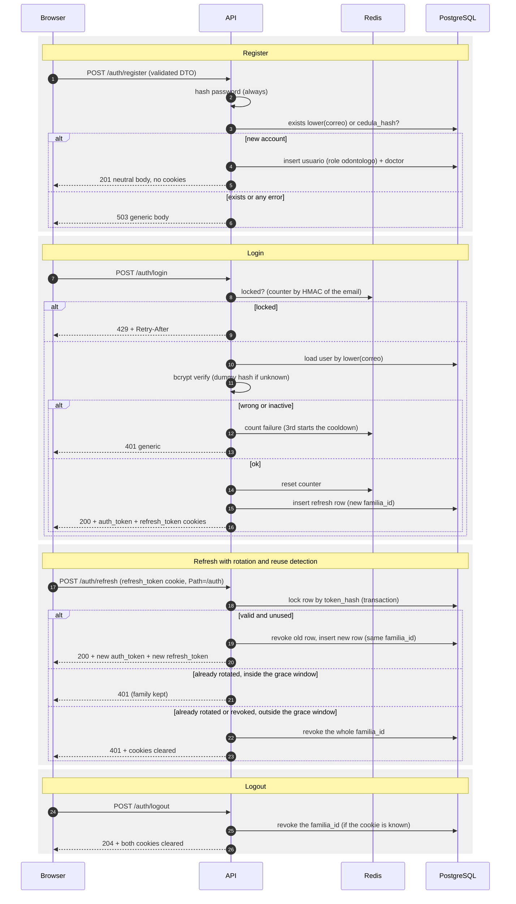

# Authentication and session security

Reference for the auth module of `apps/api` (`src/auth`). Route and field names are in Spanish, as in the code. Environment variable names are listed in section 9; values are never documented here.

## 1. Overview

- Two httpOnly cookies: `auth_token` (access JWT, 15 minutes) and `refresh_token` (opaque, 7 days, sliding).
- Every route requires a valid `auth_token` unless it is marked `@Public()` (global `JwtAuthGuard`). Roles are enforced with `@Roles(...)` and the global `RolesGuard`.
- The JWT is read from the cookie only, never from the `Authorization` header.
- The refresh token is stored only as a SHA-256 hash in `sesion_refresco` and is rotated on every use, with reuse detection.
- Login is protected by a per-email lockout and per-IP rate limits.
- The first administrator is created with a CLI, never over HTTP (section 10).



## 2. Endpoints

All bodies are JSON (limit 10 kb). Unknown fields are rejected with `400`. Validation errors never echo the submitted values. Every `/auth` response sends `Cache-Control: no-store`.

| Method and path | Auth | Request body | Success | Failures |
|---|---|---|---|---|
| `POST /auth/register` | Public | `nombres`, `apellidos`, `cedula` (5-12 digits), `correo`, `password` (12-200) | `201 {"message":"Registro completado."}`, no cookies | `400` validation; `503` generic body for ANY failure, including an existing email or cedula; `429` rate limit |
| `POST /auth/login` | Public | `correo`, `password` (1-200) | `200 {"usuario":{id,nombres,apellidos,correo,rol}}` plus both cookies | `401` identical body for unknown email, wrong password or inactive user; `429` + `Retry-After` during the lockout or rate limit; `400` validation |
| `POST /auth/refresh` | `refresh_token` cookie | none | `200 {"message":"Sesion renovada."}` plus both cookies renewed | `401` invalid, expired, revoked, reused, inactive user or session past its absolute cap (cookies cleared); `429` |
| `POST /auth/logout` | Public, idempotent | none | `204`, both cookies cleared | none expected |
| `GET /auth/me` | `auth_token` cookie | none | `200 {id,nombres,apellidos,correo,rol}` | `401` missing, invalid or expired token, or user no longer active |

The registration `503` body is: "No pudimos completar el registro en este momento. Intentalo de nuevo mas tarde." A client that gets `401` on a protected route calls `/auth/refresh` once and retries.

## 3. Cookies

| Attribute | `auth_token` | `refresh_token` |
|---|---|---|
| Content | Signed JWT (HS256) | Opaque random value (32 bytes, base64url) |
| `Path` | `/` | `/auth` |
| `Max-Age` | `ACCESS_TOKEN_TTL_SECONDS` (900 s) | `REFRESH_TOKEN_TTL_DAYS` (7 days), renewed on every refresh |
| `HttpOnly` | yes | yes |
| `SameSite` | `COOKIE_SAMESITE` (default `Strict`) | same |
| `Secure` | when `NODE_ENV=production` | same |

Why `Path=/auth` for the refresh cookie: the browser sends it only to `/auth/*`, so it never travels with ordinary API calls. That reduces its exposure in logs, proxies and any bug in a business route. Clearing a cookie uses the same attributes as setting it (a clear with a different `Path` would not remove it).

## 4. JWT claims

HS256, key from `JWT_SECRET` (base64, at least 32 bytes), lifetime `ACCESS_TOKEN_TTL_SECONDS`.

| Claim | Meaning |
|---|---|
| `sub` | User id (UUID) |
| `rol` | Role name at login time (`administrador`, `odontologo`, `asistente`) |
| `sid` | Session family id (UUID) shared with the refresh rows |
| `iat`, `exp` | Standard timestamps |

The strategy verifies the signature, the algorithm allow-list (`HS256` only), the expiry and the shape of the claims. `/auth/me` reloads the user, so a deactivated user is rejected there. The role inside a token is trusted until it expires (at most 15 minutes), so a role change takes effect after the next refresh or login.

## 5. Lockout

- Per normalized email (trimmed, lower-cased), counted in Redis under a key derived with HMAC (no raw emails in Redis).
- Unknown emails are counted exactly like known ones, so the behavior does not reveal which accounts exist.
- After `LOGIN_MAX_ATTEMPTS` (3) failed attempts a cooldown of `LOGIN_LOCK_SECONDS` (300 s, 5 minutes) starts. Attempts during the cooldown get `429` with `Retry-After`.
- A correct password is still rejected during the cooldown. The counter resets after a successful login.
- Known trade-off: an attacker who knows a victim's email can keep that account locked. The per-IP login throttle (section 6) limits how often one source can do it, but a distributed attacker can still annoy a victim. Accepted for now; MFA and alerting are follow-ups.

## 6. Rate limits

Per client IP, stored in Redis (`@nestjs/throttler` with a Redis storage). Every route is covered. Behind a proxy set `TRUST_PROXY`, otherwise all clients share the proxy IP.

| Scope | Limit | Window | Block after exceeding |
|---|---|---|---|
| Default (every route) | `THROTTLE_DEFAULT_LIMIT` (60) | `THROTTLE_TTL_MS` (60 s) | window end |
| `POST /auth/login` (extra) | 10 | 60 s | 5 minutes |
| `POST /auth/register` (extra) | 5 | 1 hour | 1 hour |
| `POST /auth/refresh` | 30 | 60 s | window end |
| `GET /health` | 120 | 60 s | window end |

Exceeding a limit returns `429` with `Retry-After`.

## 7. Generic errors and the residual enumeration risk

- Login: unknown email, wrong password and inactive user return the same `401` body. A dummy bcrypt comparison runs for unknown or inactive users so the timing is similar.
- Register: validation first (`400`), then the password is always hashed, then the existence check on `lower(correo)` and `cedula_hash`. An existing email or cedula, a race on the unique indexes and a genuine server error all return the same `503` body. The server logs only the error name and code, never the message (it can contain the submitted email or cedula).
- Residual risk: a successful registration returns `201` and a failure returns `503`. An attacker can therefore infer that an email or cedula already exists whenever they get a `503` for a payload that would otherwise be valid. This is accepted by design (product decision) and mitigated by: the `register` limit (5 per hour per IP), identical hashing work on every path, and no distinction between causes.
- Plan: add email verification and answer every registration with the same neutral `202`, sending the real outcome by email. Then the endpoint no longer leaks existence.

## 8. Password policy, headers, CORS and body limits

- Passwords: 12 to 200 characters, no composition rules (length matters more than symbols). The password is reduced with SHA-256 (base64, 44 characters) before bcrypt. Reason: bcrypt silently ignores bytes beyond 72, so two long passwords with the same first 72 bytes would be equivalent. The pre-hash makes every character count, with no truncation and no rejection. The salt and the work factor still come from bcrypt (`BCRYPT_COST`, default 12).
- Headers (helmet): strict API CSP (`default-src 'none'`, `frame-ancestors 'none'`), `Referrer-Policy: no-referrer`, `Cross-Origin-Resource-Policy: same-site`, `x-powered-by` removed, HSTS only in production.
- CORS: allow-list `CORS_ORIGINS` with credentials. Origins outside the list get no CORS headers.
- Origin check: for `POST`, `PUT`, `PATCH` and `DELETE`, a present `Origin` header must be in the allow-list, otherwise `403`. Requests without `Origin` (curl, server to server) pass. This backs up `SameSite`, which is the primary CSRF defense.
- Body: JSON only, limit 10 kb, urlencoded bodies are not parsed.
- Validation: global pipe with `whitelist`, `forbidNonWhitelisted` and `transform`. Nobody can choose a role through a payload.

## 9. Environment variables

Names and defaults only. Real values live in `apps/api/.env` (git-ignored); see `apps/api/.env.example`.

| Variable | Default | Required | Purpose |
|---|---|---|---|
| `JWT_SECRET` | none | yes | Signs the access JWT (base64, at least 32 bytes) |
| `ENCRYPTION_KEY` | none | yes | AES-256-GCM key for personal data |
| `BLIND_INDEX_KEY` | none | yes | HMAC key for the cedula blind index and the lockout keys |
| `BCRYPT_COST` | 12 | no | bcrypt work factor, 10 to 15 |
| `ACCESS_TOKEN_TTL_SECONDS` | 900 | no | `auth_token` lifetime |
| `REFRESH_TOKEN_TTL_DAYS` | 7 | no | Refresh token lifetime (sliding) |
| `SESSION_MAX_LIFETIME_DAYS` | 30 | no | Absolute cap of a session family (must be >= `REFRESH_TOKEN_TTL_DAYS`) |
| `LOGIN_MAX_ATTEMPTS` | 3 | no | Failures before the cooldown |
| `LOGIN_LOCK_SECONDS` | 300 | no | Cooldown length |
| `REFRESH_REUSE_GRACE_SECONDS` | 10 | no | A just-rotated token reused within this window is rejected without revoking the family (parallel tabs) |
| `COOKIE_SAMESITE` | strict | no | `strict` or `lax` |
| `CORS_ORIGINS` | the three local frontends | no | Comma separated allow-list |
| `TRUST_PROXY` | false | no | Express trust proxy (false, true or hop count) |
| `THROTTLE_DEFAULT_LIMIT` | 60 | no | Requests per window per IP |
| `THROTTLE_TTL_MS` | 60000 | no | Window length |
| `NODE_ENV` | development | no | `production` enables `Secure` cookies and HSTS |
| `PORT`, `DATABASE_*`, `REDIS_HOST`, `REDIS_PORT`, `REDIS_PASSWORD` | see `.env.example` | database and Redis connection |

Generate `JWT_SECRET` with `openssl rand -base64 48`. Changing it logs everybody out. Never commit or share any of these values.

## 10. Creating the first administrator

Administrators are never created over HTTP. From `apps/api`, with the containers up and migrations applied:

```sh
bun run admin:create -- --correo admin@example.com --cedula 1234567890 \
  --nombres "Ana" --apellidos "Perez"
```

- Missing fields are asked interactively. The password is always prompted twice with hidden input (no echo). It is never a command-line argument or an environment variable.
- Without a terminal the command refuses to run unless you pass `--password-stdin`; then it reads exactly one line from stdin. This is the way for automation, for example `printf '%s\n' "$PASSWORD" | bun run admin:create -- --password-stdin --correo ...`. Take the password from a secrets manager, not from a literal in a script.
- The same rules as `RegisterDto` apply. If the email or cedula already exists it prints a clear message and exits with code 1 without changing anything. Exit code 2 means bad usage.
- It creates an active user with role `administrador` and no `doctor` row, and prints only the new id, correo and role.
- Implementation: logic in `src/auth/admin-bootstrap.ts`, TTY handling in `scripts/admin-create.ts`, minimal Nest context in `src/auth/admin-cli.module.ts` (database and crypto only).

## 11. Testing

```sh
cd apps/api
bun run test       # unit tests (Vitest)
bun run test:e2e   # integration tests against live PostgreSQL and Redis (bun run infra:up first)
```

The e2e suites set test-only secrets in-process, create throwaway users and delete them afterwards. They never read or modify `.env`.

## 12. Threat notes

| Threat | Mitigation |
|---|---|
| Token theft from the browser (XSS) | httpOnly cookies, CSP, short access token |
| CSRF | `SameSite=Strict`, Origin check, JSON-only bodies, CORS allow-list |
| Stolen refresh token | Rotation on every use, reuse detection revokes the family, absolute cap, hash-only storage |
| Credential stuffing and brute force | Per-email lockout, per-IP login throttle, bcrypt with pre-hash |
| User enumeration | Identical login errors and timing; registration residual risk in section 7 |
| Account lockout abuse | Known trade-off, section 5 |
| Role confusion | Role fixed server-side; `RegisterDto` rejects unknown fields |
| Database leak | bcrypt hashes, AES-256-GCM personal data, blind index for lookups, refresh tokens stored as SHA-256 |
| Secret leakage | No secrets in logs, docs or tests; `.env` is git-ignored |

## 13. Follow-ups

- Cleanup job for expired and revoked `sesion_refresco` rows (BullMQ repeatable job).
- Email verification and password reset (needs a mail provider); then make registration neutral (`202`).
- Breached and common password check.
- MFA for administrators.
- Audit log table (logins, failures, role changes, session revocations).
- Admin endpoint to create and manage users.
- Decide the registration policy with the client: doctors belong to a clinic, so public sign-up may be replaced by managed onboarding. Public sign-ups currently get the role in the single constant `PUBLIC_REGISTRATION_ROLE` (`src/auth/auth.constants.ts`).
- Production hardening: `Secure` cookies and HSTS are on when `NODE_ENV=production` (verify behind TLS); set `TRUST_PROXY` to the real number of proxy hops.
- Key rotation for `JWT_SECRET` (support two keys during the switch), `ENCRYPTION_KEY` (re-encryption job) and `BLIND_INDEX_KEY` (rehash job).
