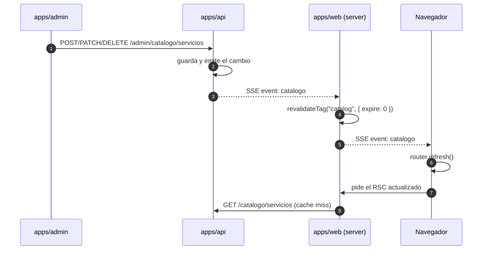

# Catálogo de servicios

Referencia del módulo de catálogo de `apps/api` (`src/catalogo`) y de su consumo desde `apps/web` y `apps/admin`. Los nombres de rutas, campos y variables de entorno están en español, como en el código. Los valores de las variables nunca se documentan aquí.

## 1. Resumen

- Un servicio tiene `nombre`, `slug`, `descripcion`, `precio` (nunca se expone en las rutas públicas), `activo` e `imagenUrl`/`imagenPublicId` de Cloudinary.
- El sitio público (`apps/web`) lee `GET /catalogo/servicios`, que responde paginado, y cachea la respuesta con el tag `catalog`. El sitio recorre todas las páginas porque esa lista alimenta también las rutas estáticas (ver `listados.md` §5).
- El panel (`apps/admin`) usa las rutas de administración con la cookie `auth_token`.
- Cada mutación emite un evento por SSE; `apps/web` invalida el tag y refresca la página.
- El PDF se genera en el backend a partir de los servicios activos y se cachea en Redis.

## 2. Modelo de datos

Tabla `servicio` (ver `database-model.md`):

| Columna                                 | Tipo          | Notas                                                |
| --------------------------------------- | ------------- | ---------------------------------------------------- |
| `id`                                    | bigint        | string numérica en la API, hasta 18 dígitos          |
| `slug`                                  | text único    | generado del nombre al crear; no cambia al renombrar |
| `nombre`                                | text          | 2–120 caracteres, único                              |
| `descripcion`                           | text null     | hasta 2000 caracteres                                |
| `precio`                                | numeric(12,2) | string con 2 decimales en la API; solo admin y PDF   |
| `activo`                                | boolean       | los inactivos no aparecen en el sitio ni en el PDF   |
| `imagen_url`                            | text null     | siempre `https://res.cloudinary.com/...`             |
| `imagen_public_id`                      | text null     | necesario para reemplazar/borrar el asset            |
| `fecha_creacion`, `fecha_actualizacion` | timestamptz   |                                                      |

## 3. Rutas públicas

Prefijo `GET /catalogo`, todas `@Public()`. Devuelven solo `{ id, slug, nombre, descripcion, imagenUrl }` y nunca `precio`.

| Ruta                            | Respuesta                                                                                                                                                                                                             |
| ------------------------------- | --------------------------------------------------------------------------------------------------------------------------------------------------------------------------------------------------------------------- |
| `GET /catalogo/servicios`       | Página de servicios activos: `{ data, total, page, size }`, `page`/`size` desde 1 y 10 por defecto (tope 100), orden por nombre con desempate por id. `Cache-Control: public, max-age=60, stale-while-revalidate=300` |
| `GET /catalogo/servicios/:slug` | Un servicio activo o 404                                                                                                                                                                                              |
| `GET /catalogo/pdf`             | PDF (`application/pdf`, `attachment; filename="catalogo-orthopro-lab.pdf"`), throttle 5/min, `no-store`                                                                                                               |
| `GET /catalogo/eventos`         | Stream SSE de cambios (sección 4)                                                                                                                                                                                     |

## 4. Eventos en tiempo real (SSE)

`GET /catalogo/eventos` responde `text/event-stream`. Por cada mutación del catálogo envía:

```
event: catalogo
data: {"tipo":"creado"}
```

`tipo` es `creado`, `actualizado`, `eliminado` o `imagen`; el módulo de contenido emite además `contenido` por el mismo bus (ver `contenido.md`). Cada 25 s envía `event: ping` para mantener viva la conexión. El stream no incluye el servicio modificado: el cliente solo lo usa como disparador y vuelve a pedir los datos.

El bus (`CatalogoEventosService`) es un `Subject` en memoria: los eventos no se persisten y no cruzan réplicas de la API. Con más de una instancia hace falta pub/sub en Redis.

Flujo completo:



## 5. Rutas de administración

Prefijo `/admin/catalogo/servicios`, rol `administrador` (cookie `auth_token`) y `Cache-Control: no-store`.

| Ruta               | Cuerpo / respuesta                                                                                                                  |
| ------------------ | ----------------------------------------------------------------------------------------------------------------------------------- |
| `GET /`            | Página de servicios con `precio`, `activo` y fechas: `{ data, total, page, size }`. Acepta `q` (nombre o descripción), `activo=true | false`y`sort`de la lista`nombre`, `precio`, `activo`, `creado`con`order=asc | desc` |
| `POST /`           | `{ nombre, descripcion?, precio, activo? }` → 201 con el servicio                                                                   |
| `GET /:id`         | Servicio o 404                                                                                                                      |
| `PATCH /:id`       | Cualquier subconjunto de los campos anteriores                                                                                      |
| `DELETE /:id`      | 204 si se borró; 200 con el servicio desactivado si tiene órdenes                                                                   |
| `POST /:id/imagen` | `multipart/form-data`, un archivo en el campo `imagen`                                                                              |

Reglas:

- La lista de administración pagina y filtra en el servidor como el resto de listados; la referencia completa del contrato (parámetros, 400 ante un `sort` desconocido, tope de 100) está en `listados.md`.
- `precio` es un string (`^\d{1,10}(\.\d{1,2})?$`); se normaliza a 2 decimales. Nunca es un número JS.
- `nombre` es único; un duplicado responde 409.
- **Borrado:** si alguna fila de `detalle_orden` referencia el servicio, solo se pone `activo = false` (se conserva la historia). Si no, se borra la fila y se elimina la imagen de Cloudinary (best effort, se registra si falla).
- **Imagen:** JPEG, PNG o WebP, máximo 5 MB, validado por magic bytes y no por el `Content-Type`. Un archivo inválido o ausente responde 400 (incluido el exceso de tamaño). El asset anterior se borra después de guardar el nuevo.

## 6. Cloudinary

Las cargas usan el SDK oficial detrás del puerto `ImageStorage`.

| Variable                | Obligatoria                 | Notas                           |
| ----------------------- | --------------------------- | ------------------------------- |
| `CLOUDINARY_CLOUD_NAME` | sí, junto con las otras dos |                                 |
| `CLOUDINARY_API_KEY`    | sí, junto con las otras dos |                                 |
| `CLOUDINARY_API_SECRET` | sí, junto con las otras dos |                                 |
| `CLOUDINARY_FOLDER`     | no                          | por defecto `orthopro/catalogo` |

Las tres credenciales son todo-o-nada: si falta una, la API no arranca. Si no se configura ninguna, el resto del catálogo funciona y `POST /:id/imagen` responde 503 con un mensaje claro.

Antes de guardar, la URL devuelta debe empezar con `https://res.cloudinary.com/<cloud_name>/`; el mismo control se aplica al descargar imágenes para el PDF (defensa SSRF).

### Probar una carga real

1. En Cloudinary, copiar cloud name, API key y API secret del dashboard.
2. Agregarlas a `apps/api/.env` (nunca commitear ese archivo):

   ```sh
   CLOUDINARY_CLOUD_NAME=...
   CLOUDINARY_API_KEY=...
   CLOUDINARY_API_SECRET=...
   # opcional
   CLOUDINARY_FOLDER=orthopro/catalogo
   ```

3. Levantar el stack y preparar el administrador:

   ```sh
   bun run infra:up
   bun run dev --filter=api --filter=web --filter=admin
   # en apps/api, si la base está vacía:
   bun run migration:run
   bun run admin:create -- --correo <email> --cedula <digitos> --nombres <texto> --apellidos <texto>
   ```

4. En `http://localhost:3002/catalogo`, crear un servicio y subir una imagen. En `http://localhost:3000/catalogo` el servicio debe aparecer sin recargar (SSE). En Cloudinary debe existir el asset bajo `orthopro/catalogo/<slug>`.
5. Alternativa por HTTP (sin el panel):

   ```sh
   # guarda las cookies de la sesión
   curl -c /tmp/op-cookies -H 'Content-Type: application/json' \
     -d '{"correo":"<email>","password":"<password>"}' \
     http://localhost:3003/auth/login

   curl -b /tmp/op-cookies -F 'imagen=@/ruta/foto.jpg' \
     http://localhost:3003/admin/catalogo/servicios/<id>/imagen
   ```

   Respuesta esperada: 200 con `imagenUrl` de Cloudinary. Sin credenciales: 503.

## 7. PDF

- Generado con `pdfkit` y las fuentes de `apps/api/assets/fonts` (Outfit y Poppins, licencia OFL).
- Incluye portada, una línea de tiempo vertical por servicio activo y pie con numeración.
- La línea de tiempo tiene un eje central: cada servicio es una tarjeta que alterna lado (izquierda, derecha, izquierda...) y se escalona, porque cada tarjeta empieza antes de que termine la anterior pero nunca se monta sobre otra tarjeta del mismo lado. Cada tarjeta lleva imagen recortada, nombre, descripción (máximo 4 líneas) y precio en COP (`Consultar valor` cuando el precio es 0); el eje y el punto de cada tarjeta los conectan.
- El panel muestra el mismo PDF embebido en `/catalogo/pdf` (pantalla "Vista previa del PDF"), servido por un proxy propio con `Content-Disposition: inline` para no forzar la descarga.
- Las imágenes se descargan de Cloudinary con transformación JPEG, timeout, tope de tamaño y allow-list de host; si fallan, el bloque se genera sin imagen.
- Se cachea en Redis (`orthopro:pdf:catalog:*`) con una clave derivada del estado del catálogo. Cada mutación invalida el cache; si Redis falla, el PDF se regenera y la mutación no falla.

## 8. Consumo desde `apps/web`

- `apps/web/lib/api-catalog.ts` envuelve `fetchServices()` con `"use cache"`, `cacheTag("catalog")` y `cacheLife("catalogo")` (perfil de `apps/web/next.config.ts`: `stale` 30 s, `revalidate` 10 s, `expire` 5 min; el `stale` no puede bajar de 30 s o el build deja de prerenderizar la ruta); el `fetch` a la API usa `next: { revalidate: 10, tags: ["catalog"] }` para que la respuesta de la API no imponga su propio `max-age`. Si la API no responde en 3 s usa el catálogo local de respaldo.
- `apps/web/app/api/catalogo/eventos/route.ts` es un puente SSE: se conecta a la API y reenvía `event: catalogo` al navegador.
- La invalidación del cache la hace `POST /api/catalogo/revalidar` (`revalidateTag("catalog", { expire: 0 })` + `revalidatePath`), y el puente la llama al recibir un evento. Tiene que ser una request aparte: `revalidateTag` solo registra el tag en las revalidaciones pendientes de la request actual, que se aplican cuando la respuesta termina, y la del puente es un stream que nunca termina.
- `apps/web/components/catalog-live.tsx` escucha el evento en el navegador y hace `router.refresh()`.
- El componente está montado una sola vez en `apps/web/app/layout.tsx`, así todas las páginas reaccionan a un cambio de catálogo o de contenido.
- `apps/web/app/api/catalogo/pdf/route.ts` sirve el PDF desde el origen del sitio ("Ver precios") reenviando `GET /catalogo/pdf` de la API; así la descarga no depende de que la API sea pública.

Sin la API, el sitio sigue mostrando el catálogo de respaldo (`apps/web/lib/catalog.ts`) y el PDF devuelve 502: el sitio no depende de la API para renderizar.

El catálogo cambia casi al instante mientras haya una pestaña del sitio abierta (el evento SSE refresca la página). Sin ninguna pestaña abierta, la copia cacheada se renueva sola cada 10 s.

## 9. Variables de entorno

Las credenciales de Cloudinary están en la sección 6. `apps/api` necesita además `DATABASE_*`, `REDIS_*`, `JWT_SECRET` y las variables de seguridad descritas en `auth.md`. `apps/web` necesita `API_BASE_URL` (por defecto `http://localhost:3003`).

## 10. Pruebas

```sh
bunx turbo run lint check-types test --filter=api
bunx turbo run lint build --filter=web
bunx turbo run lint check-types test --filter=admin
```

- `src/catalogo/*.spec.ts`: servicio (regla de borrado, imágenes, emisión de eventos), validación de imágenes, storage de Cloudinary, PDF y slugs.
- `test/catalogo.e2e-spec.ts`: rutas públicas y de administración contra PostgreSQL y Redis reales (`bun run infra:up`).
- Las pruebas nunca llaman a Cloudinary: usan `FakeImageStorage`.
