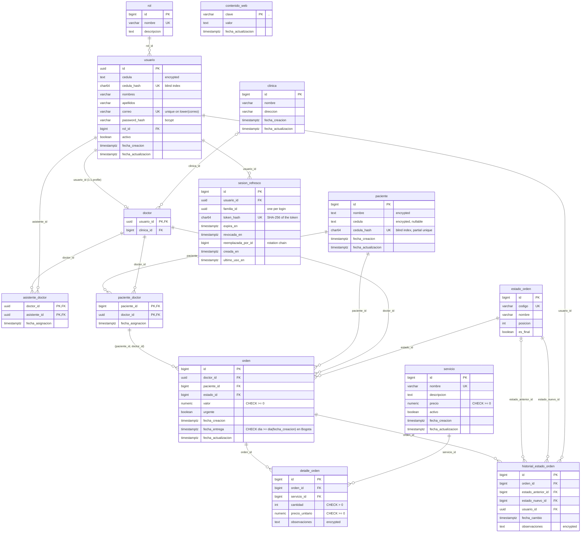

# OrthoPro Lab database model

Reference for the PostgreSQL 17 schema owned by `apps/api` (TypeORM, migrations only, `synchronize: false`). The authoritative DDL is [`schema.sql`](./schema.sql), generated from the migrated database. Table and column names are in Spanish (domain language); code comments are in English.

Status: provisional until the open questions in section 6 are answered by the client.

## 1. Overview and design principles

14 application tables (plus TypeORM's `migrations` bookkeeping table) in the `public` schema.

- **Mixed identifiers.** `usuario.id` is a UUID (`gen_random_uuid()`, built in since PG 13) because it will appear in tokens and URLs and must not be guessable. Every other table uses `bigint GENERATED ALWAYS AS IDENTITY`. Catalog tables (`rol`, `estado_orden`) also use bigint ids and expose a stable business key (`nombre`, `codigo`).
- **One role per user.** `usuario.rol_id` is a single FK to `rol`. There is no user-role join table.
- **Doctor is a profile of a user.** `doctor.usuario_id` is both PK and FK to `usuario` (1:1). A doctor has at most one clinic (`doctor.clinica_id`, nullable).
- **Patient N:M doctor.** `paciente_doctor` holds the assignment. An order must reference a patient that is assigned to the order's doctor (composite FK, see section 4).
- **Assistants.** `asistente_doctor` links an assistant user to a doctor user (N:M, unique pair, never the same user).
- **Historical price.** `detalle_orden.precio_unitario` is copied from `servicio.precio` when the order line is created, so later price changes never alter past orders. The line subtotal (`cantidad * precio_unitario`) is computed, not stored.
- **Stored order total.** `orden.valor` is a stored total. The application service must keep it equal to the sum of its lines (see section 4).
- **Append-only status history.** `historial_estado_orden` records every status transition (previous state nullable for the first one, new state, user, timestamp, notes). Rows are never updated or deleted by the application.
- **All foreign keys are `ON DELETE RESTRICT`.** Clinical and commercial records must not disappear through a cascade. Deleting a parent that is still referenced fails; the application deactivates instead (`usuario.activo`, `servicio.activo`). This also applies to `detalle_orden.orden_id`: orders are not physically deleted.
- **Timestamps** are `timestamptz`, defaulting to `now()`. Money is `numeric(12,2)`.

## 2. Entity-relationship diagram



`contenido_web` is a standalone key/value table: no FKs.

`orden` carries two FKs touching the patient and the doctor: the composite `(paciente_id, doctor_id) -> paciente_doctor` (the one that matters) plus the single-column FKs to `paciente` and `doctor`.

## 3. Data dictionary

Types as in PostgreSQL. "Enc" = encrypted at application level (stored as text, see section 5).

### rol
| Column | Type | Null | Notes |
|---|---|---|---|
| id | bigint identity | no | PK |
| nombre | varchar | no | Unique |
| descripcion | text | yes | |

### usuario
| Column | Type | Null | Notes |
|---|---|---|---|
| id | uuid | no | PK, default `gen_random_uuid()` |
| cedula | text | no | Enc |
| cedula_hash | char(64) | no | Blind index (HMAC-SHA256 hex), unique |
| nombres | varchar | no | |
| apellidos | varchar | no | |
| correo | varchar | no | Unique on `lower(correo)` |
| password_hash | varchar | no | bcrypt hash |
| rol_id | bigint | no | FK `rol`, RESTRICT |
| activo | boolean | no | Default true |
| fecha_creacion | timestamptz | no | Default `now()` |
| fecha_actualizacion | timestamptz | no | Default `now()` |

### sesion_refresco
Refresh-token sessions (see [auth.md](./auth.md)). Only the SHA-256 hash of the opaque token is stored. No IP or user-agent is kept.

| Column | Type | Null | Notes |
|---|---|---|---|
| id | bigint identity | no | PK `pk_sesion_refresco` |
| usuario_id | uuid | no | FK `usuario`, RESTRICT, indexed |
| familia_id | uuid | no | Shared by every token of one login; indexed |
| token_hash | char(64) | no | SHA-256 hex of the token, unique |
| expira_en | timestamptz | no | Sliding expiry of this token, indexed |
| revocada_en | timestamptz | yes | Set on rotation, logout or reuse detection |
| reemplazada_por_id | bigint | yes | Id of the token that replaced this one (no FK) |
| creada_en | timestamptz | no | Default `now()` |
| ultimo_uso_en | timestamptz | no | Default `now()` |

### clinica
| Column | Type | Null | Notes |
|---|---|---|---|
| id | bigint identity | no | PK |
| nombre | varchar | no | |
| direccion | varchar | yes | |
| fecha_creacion | timestamptz | no | Default `now()` |
| fecha_actualizacion | timestamptz | no | Default `now()` |

### doctor
| Column | Type | Null | Notes |
|---|---|---|---|
| usuario_id | uuid | no | PK and FK `usuario`, RESTRICT |
| clinica_id | bigint | yes | FK `clinica`, RESTRICT |

### asistente_doctor
| Column | Type | Null | Notes |
|---|---|---|---|
| doctor_id | uuid | no | PK part, FK `doctor` |
| asistente_id | uuid | no | PK part, FK `usuario` |
| fecha_asignacion | timestamptz | no | Default `now()` |

### paciente
| Column | Type | Null | Notes |
|---|---|---|---|
| id | bigint identity | no | PK |
| nombre | text | no | Enc |
| cedula | text | yes | Enc (minors may have none) |
| cedula_hash | char(64) | yes | Blind index; partial unique where not null |
| fecha_creacion | timestamptz | no | Default `now()` |
| fecha_actualizacion | timestamptz | no | Default `now()` |

### paciente_doctor
| Column | Type | Null | Notes |
|---|---|---|---|
| paciente_id | bigint | no | PK part, FK `paciente` |
| doctor_id | uuid | no | PK part, FK `doctor` |
| fecha_asignacion | timestamptz | no | Default `now()` |

### servicio
Catalog of lab services. Migration `AddCatalogFieldsToServicio` added `slug`, `imagen_url` and `imagen_public_id` (existing rows get a slug backfilled before `NOT NULL`); migration `SeedCatalogServices` inserts the four website lines (Ortodoncia Fija, Ortodoncia Removible, Alineadores Invisibles, Retenedores y Ferulas) with a PROVISIONAL `precio = 0.00`, idempotently. **Exposure rule:** the public endpoints (`GET /catalogo/servicios[/:slug]`) return only `id, slug, nombre, descripcion, imagenUrl` of active services, never `precio`, `activo`, `imagen_public_id` or timestamps; the admin endpoints (`/admin/catalogo/servicios`, role `administrador`) return everything except `imagen_public_id`. A service referenced by `detalle_orden` is deactivated instead of deleted.

| Column | Type | Null | Notes |
|---|---|---|---|
| id | bigint identity | no | PK |
| slug | varchar | no | Unique index `uq_servicio_slug`; generated from `nombre` at creation and never regenerated (stable public URLs) |
| nombre | varchar | no | Unique |
| descripcion | text | yes | |
| precio | numeric(12,2) | no | CHECK >= 0 |
| imagen_url | text | yes | Cloudinary URL; CHECK `ck_servicio_imagen_url_cloudinary` (null or starts with `https://res.cloudinary.com/`) |
| imagen_public_id | text | yes | Cloudinary asset id, internal: needed to replace or delete the image; never returned by the API |
| activo | boolean | no | Default true |
| fecha_creacion | timestamptz | no | Default `now()` |
| fecha_actualizacion | timestamptz | no | Default `now()` |

### estado_orden
| Column | Type | Null | Notes |
|---|---|---|---|
| id | bigint identity | no | PK |
| codigo | varchar | no | Unique business key |
| nombre | varchar | no | Display name |
| posicion | integer | no | Order in the lifecycle |
| es_final | boolean | no | Default false |

### orden
| Column | Type | Null | Notes |
|---|---|---|---|
| id | bigint identity | no | PK |
| doctor_id | uuid | no | FK `doctor`; part of composite FK |
| paciente_id | bigint | no | FK `paciente`; part of composite FK |
| estado_id | bigint | no | FK `estado_orden` |
| valor | numeric(12,2) | no | Default 0, CHECK >= 0, maintained by the service |
| urgente | boolean | no | Default false |
| fecha_creacion | timestamptz | no | Default `now()` |
| fecha_entrega | timestamptz | yes | Día calendario a las 12:00 UTC; CHECK null or day(Bogotá) >= day(`fecha_creacion`) |
| fecha_actualizacion | timestamptz | no | Default `now()` |

### detalle_orden
| Column | Type | Null | Notes |
|---|---|---|---|
| id | bigint identity | no | PK |
| orden_id | bigint | no | FK `orden`, RESTRICT |
| servicio_id | bigint | no | FK `servicio` |
| cantidad | integer | no | Default 1, CHECK > 0 |
| precio_unitario | numeric(12,2) | no | Historical price, CHECK >= 0 |
| observaciones | text | yes | Enc |

### historial_estado_orden
| Column | Type | Null | Notes |
|---|---|---|---|
| id | bigint identity | no | PK |
| orden_id | bigint | no | FK `orden` |
| estado_anterior_id | bigint | yes | FK `estado_orden`; null for the first entry |
| estado_nuevo_id | bigint | no | FK `estado_orden` |
| usuario_id | uuid | no | FK `usuario`, who made the change |
| fecha_cambio | timestamptz | no | Default `now()` |
| observaciones | text | yes | Enc |

### contenido_web
Editable copy of the public site (see [contenido.md](./contenido.md)). Key/value: one row per field an administrator changed. A missing row means "the site uses its own default text"; saving an empty value deletes the row. The field schema (groups, labels, types, limits) lives in code (`src/contenido/contenido.schema.ts`), not in the database.

| Column | Type | Null | Notes |
|---|---|---|---|
| clave | varchar(120) | no | PK `pk_contenido_web`; follows `<pagina>.<seccion>.<campo>`, e.g. `home.hero.titulo` |
| valor | text | no | Text, `/images/...` path for image fields, or opaque string for the account number; never empty |
| fecha_actualizacion | timestamptz | no | Default `now()`, updated by TypeORM on each write |

## 4. Integrity rules

### Enforced by the database
- **Composite FK** `orden (paciente_id, doctor_id) -> paciente_doctor (paciente_id, doctor_id)`: an order can only exist for a patient assigned to that doctor.
- **CHECK constraints**: `ck_asistente_doctor_distintos` (doctor <> assistant), `ck_detalle_orden_cantidad` (> 0), `ck_detalle_orden_precio` (>= 0), `ck_orden_valor_no_negativo` (>= 0), `ck_orden_fecha_entrega` (null or its calendar day in `America/Bogota` >= the creation day, so a same-day delivery is valid), `ck_servicio_precio_no_negativo` (>= 0), `ck_servicio_imagen_url_cloudinary` (image URL is null or a Cloudinary https URL).
- **Unique constraints**: `rol.nombre`, `servicio.nombre`, `servicio.slug` (`uq_servicio_slug`), `estado_orden.codigo`; composite PKs on `asistente_doctor` and `paciente_doctor`.
- **Functional unique index** `uq_usuario_correo_lower` on `lower(correo)`: case-insensitive unique email.
- **Unique index** `uq_sesion_refresco_token_hash` on `sesion_refresco.token_hash`; support indexes `idx_sesion_refresco_usuario`, `idx_sesion_refresco_familia`, `idx_sesion_refresco_expira`.
- **Unique index** `uq_usuario_cedula_hash` on `usuario.cedula_hash`.
- **Partial unique index** `uq_paciente_cedula_hash` on `paciente.cedula_hash WHERE cedula_hash IS NOT NULL`: unique cedula, several patients without one.
- **Support indexes**: `idx_orden_doctor_fecha`, `idx_orden_estado`, `idx_orden_paciente`, `idx_detalle_orden_orden`, `idx_historial_orden_fecha`.
- **All FKs RESTRICT** (see section 1).

### Application-level rules (TODO in the services still to be built)
- TODO: `doctor.usuario_id` must belong to a user whose role is `odontologo`; `asistente_doctor.asistente_id` to a user with role `asistente`. Cross-table role checks are not expressible as a plain FK/CHECK.
- TODO: `orden.valor` must equal the sum of `cantidad * precio_unitario` over its `detalle_orden` rows, recalculated in the same transaction as any line change.
- TODO: `detalle_orden.precio_unitario` must be copied from `servicio.precio` at creation (only active services).
- TODO: every status change must insert a `historial_estado_orden` row and update `orden.estado_id` in the same transaction; `estado_anterior_id` must equal the current state; allowed transitions are not enforced by the DB.
- TODO: `historial_estado_orden` is append-only; there is no trigger preventing UPDATE/DELETE, so the services must never issue them.
- TODO: keep `fecha_actualizacion` current on updates (no trigger).
- `sesion_refresco`: rotation, reuse detection, the absolute session cap and revocation are done by `SessionsService` (see [auth.md](./auth.md)). `reemplazada_por_id` is not a foreign key. Expired rows are not deleted yet (follow-up: BullMQ cleanup job), and because FKs are RESTRICT a user with sessions cannot be deleted until those rows are removed.
- TODO: normalize cedula before hashing (done by the `cedulaHash` helper) and always set `cedula_hash` together with `cedula`.

## 5. Personal data protection

Context: Ley 1581 de 2012 (habeas data) requires the controller to adopt "medidas tecnicas, humanas y administrativas necesarias" to keep data secure (arts. 4 g, 17 d, 18 b). The law names no cipher or algorithm. Health data is sensitive data (art. 5). What follows is recommended practice, not a legal certification, and needs legal review.

| Column | Protection | Why |
|---|---|---|
| `usuario.password_hash` | bcrypt hash (cost from `BCRYPT_COST`, default 12, allowed 10-15) | Passwords are never recoverable |
| `paciente.nombre`, `paciente.cedula`, `usuario.cedula` | AES-256-GCM, payload `v1:iv:tag:ciphertext` | Identifies a patient in a health context |
| `detalle_orden.observaciones`, `historial_estado_orden.observaciones` | AES-256-GCM, same format | Free-text clinical notes |
| `usuario.cedula_hash`, `paciente.cedula_hash` | HMAC-SHA256 hex (blind index) of the normalized cedula, separate key | Exact-match lookup and uniqueness without decrypting |
| Everything else (names of staff, `correo`, clinic data, prices, dates, states) | Plain | Needed for search, joins, sorting and uniqueness; lower sensitivity. Staff names and email are still personal data, protect them with access control and TLS |

Key variables (validated at startup, values never logged or documented):
- `ENCRYPTION_KEY`: base64 of 32 random bytes, AES-256-GCM key.
- `BLIND_INDEX_KEY`: base64 of 32 random bytes, must differ from `ENCRYPTION_KEY`.
- `BCRYPT_COST`: integer 10 to 15, optional.

Looking up by cedula: never query the encrypted column. Compute `cedulaHash(cedula)` (from `src/crypto`, normalizes then HMACs) and filter on `cedula_hash`.

Consequences:
- No search by name, `ILIKE` or ordering on encrypted columns. Any such feature needs another design (for example a separate tokenized index) and a privacy review.
- **Losing `ENCRYPTION_KEY` makes the encrypted data unrecoverable.** Changing `BLIND_INDEX_KEY` breaks all cedula lookups until the hashes are recomputed.
- Rotation needs a re-encryption job (the `v1:` prefix allows versioned keys); it does not exist yet.

Still outside the code (operations and legal):
- Production key management and rotation (secrets manager, backup of keys separate from data).
- Encrypted backups.
- TLS to PostgreSQL (and Redis).
- Access audit log (who read which patient).
- Data retention policy.
- Privacy policy and holder authorization (consent) records.

## 6. Seeds and open questions for the client

Seed migration `SeedCatalogs` inserts provisional catalogs:
- Roles: `administrador`, `odontologo`, `asistente`.
- Order states: `recibida`, `en_produccion`, `terminada`.

Questions:
1. Are those roles and states right? What are the real names and permissions?
2. A doctor has ONE clinic today. Do doctors work in several clinics? (An N:M `doctor_clinica` would be a later migration.)
3. Patient cedula is nullable (minors, foreigners). Is another identifier needed?
4. ~~What happens after `terminada`: `entregada`, `cancelada`, `devuelta`? Which transitions are allowed and who may perform them?~~ **Resuelto:** `cancelada` y `terminada` son estados finales (`es_final = true`) y no admiten transición posterior. Una orden se puede cancelar desde cualquier estado no final (`creada`, `recibida`, `en_proceso`, `en_entrega`, `devuelta_correccion`), desde el portal Administrador o el de Clientes, solo por la acción de cancelación (`DELETE /ordenes/:id`, `DELETE /mi-clinica/ordenes/:id`), que registra el motivo en `historial_estado_orden`. `PATCH /ordenes/:id/estado` rechaza `cancelada` como destino. Editar la orden sigue permitido solo en `creada`.
5. Which status changes trigger a notification (WhatsApp)? To whom?
6. Can an assistant create orders on behalf of a doctor?
7. Retention period for patient and order data.

## 7. Working with the schema

Run from `apps/api`; the containers must be up (`bun run infra:up` from the repo root, after `systemctl --user start podman.socket`).

| Task | Command |
|---|---|
| Show migration state | `bun run migration:show` |
| Apply migrations | `bun run migration:run` |
| Revert the last migration | `bun run migration:revert` |
| Generate a migration from entity changes | `bun run migration:generate -- src/database/migrations/<Name>` (review and hand-fix; "No changes" means entities and DB agree) |
| Regenerate `docs/schema.sql` | `bun run db:schema` (needs infra up and migrations applied) |

Reset the local database (destroys all local data):

```sh
bun run infra:down                       # from the repo root
podman volume rm orthopro_orthopro_postgres_data  # <compose project>_<volume> from compose.yaml
bun run infra:up
bun run migration:run                    # from apps/api
```

If the volume name differs on your machine, check it with `podman volume ls`. Migration `ProtectPersonalData` aborts (up and down) when the affected tables already have rows, so reset only a development database.
